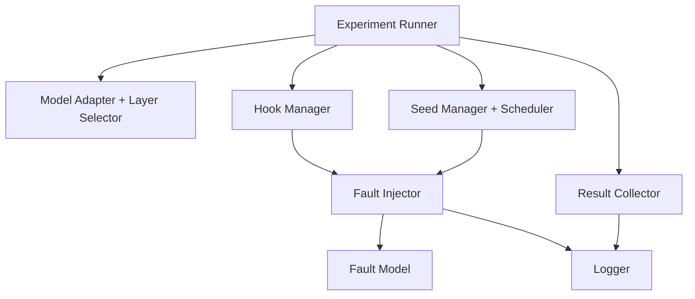

# A05 — Activation Fault Injection Specification for YOLOv8s

Date: 2026-11-16 (Asia/Tehran). Version: 1.0. Status: **DESIGN PROPOSAL — AWAITING RESEARCHER REVIEW; NOT IMPLEMENTED OR EXECUTED**.

Requested destination: `/content/drive/MyDrive/YOLOv8_Fault_Tolerance/code/docs/research_reports/a05_activation_injection_specification_v1.md`.

Normative language: MUST is a proposed implementation acceptance requirement; SHOULD is a preferred design with documented alternatives. These requirements become the implementation contract only after researcher approval. All numerical workloads below are proposed budgets, not completed experiments or time estimates.

## 1. Executive Summary

Build a separate, reproducible Activation Fault Injection framework around the existing pretrained YOLOv8s checkpoint. Do not rewrite YOLO, run the historical notebook, reuse its global state, or combine activation injection with the 07b weight-protection pilot.

| Decision | Proposed v1 choice | Technical/research reason |
|---|---|---|
| Model | Original pretrained `yolov8s.pt`, FP32 weights and activations; no logical weight quantization | Isolate activation intervention from quantization and weight faults |
| Execution | Eager PyTorch raw DetectionModel, eval/inference mode, batch 1, fixed 640×640 preprocessing | Make module calls, images and event accounting explicit |
| Target identity | Canonical named modules under the raw model, bound to an architecture manifest | Traversal indices are not stable identities across versions/models |
| Boundary | Output of the complete standard Ultralytics Conv wrapper, after its activation | Avoid shared activation-module aliases; clearer feature-output semantics |
| Fusion | Explicitly unfused reference arm, runtime verified; never silently fuse/defuse | Preserve one interpretable graph; fused arm later uses its own baseline |
| Fault | One scalar replaced with FP32 +0.0 at one pre-frozen NCHW coordinate | Simple, finite erasure-style intervention; not a hardware bit-flip claim |
| Scheduling | Exactly one scheduled callback event per faulty image, no event in clean/warm-up | Eliminate uncontrolled multi-injection and warm-up contamination |
| Initial targets | Candidate wrappers `model.0`, `model.5`, `model.15.cv2` | Small early/mid/neck coverage without entering Detect |
| Evaluation | Paired identical images, official bbox COCOeval AP plus defined fixed-threshold P/R, raw/NMS changes and measured overhead | Final detection behavior must be assessed beyond MAE |
| Scope gate | 18-event development engineering check before any larger campaign | Validate machinery before consuming GPU resources |

Actual loaded graph, target existence, tensor shapes, fusion state, runtime versions and achievable determinism: **NEEDS RUNTIME VERIFICATION**. No compatibility or performance result is established by A05.

## 2. Research Context

### 2.1. Established state and provenance

Project repository: `kianaadineh/yolov8-fault-tolerance`; branch `main`; last previously verified commit used as the source anchor:

```text
8425d543128dd115a810d6219b9cc39b2b6ecdc6
```

This is a historical source anchor, not a newly verified live Colab HEAD. Existing weight campaigns and reports remain unchanged.

The current A04 file was read directly. It establishes that the audited current source tree had no integrated activation injector, while a historical real replacement injector exists in `Colab Notebooks/project.ipynb`. A05 uses A04's cell references, without reopening/executing/modifying that historical notebook. Its recorded hash remains:

```text
fb59323e42372a96ea8074461dcbac2d6a592065fe5cbb39b025acb2fab40a7f
```

A04 references: historical model identity cell 8; observers cells 14–16; injector cells 19–23; selectors cells 27–47; replacement models cells 53/55/57; exception-unsafe/global manager cells 65/67/71. Only SingleValueFault has saved execution evidence. These are historical facts from the audit, not current YOLOv8s validation.

| Research category | Meaning | Relationship to A05 |
|---|---|---|
| A. Weight Fault Injection | Corrupt model parameters | Existing separate project line |
| B. Activation Fault Injection | Corrupt an intermediate forward tensor | The framework specified here |
| C. Weight Fault Protection | Preserve/restore parameters | 07a/07b and other existing pilots; not part of this injector |
| D. Activation Fault Protection | Detect/limit/repair activation corruption | Future separately evaluated mechanism; not supplied by an injector |

### 2.2. Sources actually inspected for this design

Local supplied report: `/workspace/scratch/013d81bc6172/upload/Pasted text(2).txt` (comprehensive project-state report).

Existing Drive report: `/content/drive/MyDrive/YOLOv8_Fault_Tolerance/code/docs/research_reports/a04_activation_injection_audit_v1.md` ([Drive](https://drive.google.com/file/d/1r4qa-Kews7_PwfujLRw5KY6RBPTUUjXJ/view)).

Repository files read at the commit above; paths below are relative to `/content/drive/MyDrive/YOLOv8_Fault_Tolerance/code/`:

1. `requirements.txt` — project pin `ultralytics==8.4.189`; historical environment is not a live runtime assertion.
2. `results/fault_injection/weight_fault_scope_v1.json` — recorded 64 Conv2d modules, 63 weight-eligible, fixed DFL exclusion; this is not an activation-target manifest.
3. `experiments/notebook05/coco2017_split_manifest_v1.json` — 1,000 development, 4,000 held_out and 50 pilot IDs, with provenance/limitations.
4. `experiments/notebook05b/screening_image_manifest_v1.json` — frozen 200-image development screening subset; 76 categories present.
5. `experiments/notebook05b/int8_screening_plan_v1.sha256.json` — old weight-campaign plan identity, not an activation plan.
6. `docs/research_reports/05a_shared_INT8_clean_baseline_card_v1.md` — logical INT8 weights with FP32 activations; not the new original-FP32 baseline.

Official sources, read as text only:

- [U1: YOLOv8 architecture, Ultralytics v8.4.189](https://github.com/ultralytics/ultralytics/blob/v8.4.189/ultralytics/cfg/models/v8/yolov8.yaml), lines 8–49.
- [U2: Conv, Ultralytics v8.4.189](https://github.com/ultralytics/ultralytics/blob/v8.4.189/ultralytics/nn/modules/conv.py), class Conv and forward/forward_fuse, lines 48–99.
- [U3: BaseModel fusion, Ultralytics v8.4.189](https://github.com/ultralytics/ultralytics/blob/v8.4.189/ultralytics/nn/tasks.py), fuse/is_fused, lines 243–290.
- [P1: PyTorch 2.14 Module hook API](https://docs.pytorch.org/docs/2.14/generated/torch.nn.Module.html#torch.nn.Module.register_forward_hook).
- [P2: PyTorch 2.14 reproducibility notes](https://docs.pytorch.org/docs/2.14/notes/randomness.html).
- [C1: Official pycocotools COCOeval source](https://github.com/cocodataset/cocoapi/blob/master/PythonAPI/pycocotools/cocoeval.py), Params.setDetParams and summary routines.

Pinned upstream U1–U3 were retrieved through the GitHub read connector after web retrieval of their tag URLs failed. No package was installed or imported to inspect them. Source-level expectations do not prove the installed package or checkpoint matches those sources. P1/P2 document one candidate PyTorch version; the implementation must verify the actual selected environment, not assume the historical GPU/CPU snapshots are interchangeable.

## 3. Target Layer Specification

### 3.1. Expected architecture versus actual runtime

U1 defines the small-scale depth/width multipliers as 0.33/0.50, with a backbone containing Conv, C2f and SPPF, a multi-scale neck, and Detect consuming stages 15, 18 and 21. The recorded project model has 11,166,560 parameters and 64 Conv2d modules (project weight-scope JSON). These counts are sanity checks, not a substitute for graph identity.

The standard model's expected stage map is:

| Raw-model prefix | Expected role from U1 | v1 targeting policy |
|---|---|---|
| `model.0` to `model.9` | Backbone, including C2f and SPPF | Standard Conv wrappers eligible after verification |
| `model.10` to `model.21` | Upsample/Concat and multi-scale neck | Standard Conv wrappers eligible after verification |
| `model.22` | Detect subtree | Excluded in phase 1, including all its descendant wrappers |
| `model.22.dfl` and `.dfl.conv` | DFL projection/decode component | Excluded; separate future experiment |

The exact child names and runtime graph are **NEEDS RUNTIME VERIFICATION**. Do not interpret the existing count of 63 weight targets as 63 activation targets. Weight eligibility and activation-boundary eligibility are different populations.

### 3.2. Canonical names and target manifest

The Model Adapter owns a single raw PyTorch DetectionModel. Canonical names are relative to that raw model (`model.0`), not relative to the outer YOLO wrapper (`model.model.0`). Unwrapping occurs once and is recorded. No selector may guess the root by chaining `.model` repeatedly.

Use exact fully qualified names plus exact module class and parent/child signature. An index may be stored as a display field only. Names are stable only within a pinned architecture/version/hash; they are not universal identifiers across YOLO variants. Missing or ambiguous names cause TARGET_MISMATCH; no fallback to nearest index/name.

Before a campaign, a future authorized inventory step MUST materialize a versioned manifest containing:

- canonical name, fully qualified class, stage/role and ancestor names;
- child signature, Conv kernel/stride/channels/groups and BN/activation types;
- fusion classification per target, forward variant and module-alias/shared-instance map;
- weight/checkpoint/source/architecture hashes, eval flags;
- output structure, tensor shape/dtype/device/stride/layout and call count for the fixed input profile;
- eligibility, exclusion reason, occurrence policy, manifest hash.

Shape observations require future no-injection runtime probes; none are available from A05. Shared instances MUST be detected by identity-aware traversal (including duplicate references), not only the default deduplicated named-module listing.

### 3.3. Target types and phase-1 candidates

| Type | Mechanism | Decision and reason |
|---|---|---|
| Exact standard Ultralytics `Conv` wrapper | Forward-output replacement | Primary; has a defined final activation output |
| Leaf `nn.Conv2d` | Forward-output replacement | Future pre/post-fusion boundary arm; not interchangeable with wrapper output |
| `nn.BatchNorm2d` | Forward-output replacement | Future unfused Conv-BN arm; cannot exist after BN fusion |
| Standalone activation | Forward output or consumer input | Not primary: shared activation objects can create cross-layer callbacks |
| C2f/SPPF larger block | Explicit tensor-output contract | Later scale/block study; different abstraction and propagation distance |
| Concat/Upsample | Explicit input/output tree adapter | Later; may have multiple inputs and different physical interpretation |
| Detect/DFL | Dedicated adapter and protocol | Separate; structured outputs and decode semantics complicate comparisons |

U2 uses a class-level default activation instance. Consequently, do not attach the main injector to a `.act` object just because its path looks unique: it may be aliased by other wrappers. Hook the uniquely verified parent Conv wrapper instead. Reject shared target wrappers in v1.

Proposed phase-1 candidate manifest:

| Canonical name | Role | Analytical expected NCHW at square 640 input | Acceptance |
|---|---|---|---|
| `model.0` | Early backbone | `[1,32,320,320]` | Exact standard Conv, BN+SiLU, unique instance, one call |
| `model.5` | Mid/deeper backbone | `[1,256,40,40]` | Same contract |
| `model.15.cv2` | Neck Conv wrapper at P3 feature stage | `[1,128,80,80]` | Same contract; outside Detect subtree |

Shapes are architecture-derived predictions, **not observed facts**. A mismatch blocks the campaign pending manifest review. Do not silently select replacement layers. Three targets provide engineering coverage, not a complete layer-sensitivity ranking.

DFL exclusion does not imply immunity. Detection head internals should later form a separate stratum (box/class branches and DFL), each with explicit tensor and metric contracts. This prevents the phase-1 pilot from mixing feature corruption with corruption of the decoded prediction interface.

## 4. Injection Boundary

### 4.1. Boundary comparison

| Boundary ID | Unfused meaning / proposed hook | Fused meaning / availability | Research consequence |
|---|---|---|---|
| `conv_linear_out` | Leaf `.conv` output, before BN/activation | Fused Conv includes BN effect; not the same pre-BN quantity | Measures perturbation before subsequent normalization; magnitude and interpretation differ after fusion |
| `conv_bn_out` | `.bn` output, before activation | No standalone BN output module; fused `.conv` is an effective post-BN linear boundary | Allows activation-function filtering to be studied; roundoff/graph differences still require separate arms |
| `conv_block_out` | Complete wrapper output after Conv-BN-SiLU | Complete wrapper output after fused Conv-SiLU | Clear feature-output boundary; primary choice, with fusion mode retained in identity |
| `large_block_out` | C2f/SPPF output tensor | Depends on verified block graph | Changes propagation distance and amount of intervened computation; cannot pool with Conv-level results |

U2 defines the ordinary and fused Conv forwards; U3 replaces the Conv object, deletes BN and switches the forward path during fusion. Fusion can invalidate previously bound leaf-module handles. Therefore all graph preparation MUST finish before manifest binding or hook attachment. No fusion, compilation, backend export or structural mutation may occur during a paired run.

Primary phase-1 configuration: `conv_block_out`, **verified unfused** standard Conv wrappers, SiLU activation. If the loaded checkpoint is already fused, stop with FUSION_MISMATCH. Do not reconstruct missing BN or automatically switch to a fused arm. A future fused arm needs a new graph fingerprint and its own clean baseline; do not pool exact tensor differences across fused/unfused graphs.

Forward-output hooks are appropriate because they can return a replacement after the module runs (P1). A pre-forward hook changes a consumer's input and may affect only one branch of a fan-out; this is a different boundary and is not the phase-1 substitute. At a wrapper output, the changed tensor is passed to all downstream consumers that receive that returned value; source graph routing must be preserved.

### 4.2. Physical interpretation

The v1 model is a transient software-visible activation-value corruption at a selected boundary. It does not emulate an identified physical SRAM address, instruction, ECC state, duration in clock cycles, or hardware probability. A post-SiLU injected negative value in a future fault model may lie outside the usual feature range; that is legitimate for post-operation corruption and must not be silently re-clipped. Value replacement and bit flips remain separately labelled.

## 5. Fault Model Comparison

| Model | Precise definition | Required parameters / record | Phase and interpretation |
|---|---|---|---|
| Single Value Replacement | Replace one `[n,c,h,w]` scalar with dtype-cast constant | Coordinate, replacement and before/after values/bits | Phase 1: +0.0; finite erasure-style perturbation |
| Line Replacement | Replace `[n,c,h,:]` across full width | Row, width, replacement, addressed/changed counts | Later; correlated spatial row, not one scalar or proven memory-line layout |
| Block Replacement | Replace one channel's in-bounds rectangular `[h:h+bh,w:w+bw]` | Top-left, bh/bw, overlap policy, replacement | Later; reject invalid extent, no automatic clipping; spatial block is not automatically a hardware burst |
| FP32 Bit Flip | Reinterpret one scalar as its 32-bit IEEE-754 pattern and XOR exactly one bit | Bit numbering, uint32 hex before/after, class before/after, scalar coordinate | Later hardware-oriented arm: bits 0–22 fraction, 23–30 exponent, 31 sign |
| FP16/BF16 Bit Flip | Same principle using actual 16-bit format | Actual dtype, layout, exponent/fraction/sign map | Later; cannot reuse FP32 bit indices or merely cast FP32 output |
| Quantized activation corruption | Corrupt integer activation codes at a real quantized boundary | Signedness, bit width, scale, zero-point, quantizer/clipping, backend | Later only after a validated quantized activation pipeline exists |

No float-to-integer numerical cast qualifies as a floating-point bit flip. A later bit-flip implementation must preserve unaffected bits, use validated byte order/bit numbering, distinguish NaN/Inf/subnormal/signed-zero cases, and verify device reinterpretation semantics. Integer bit helpers used on weights do not establish this implementation.

### 5.1. Phase-1 fault contract

Chosen model: `single_value_replacement_v1`, replacement `+0.0`, actual tensor dtype FP32, one event, one addressed scalar. Reason: deterministic, simple to validate and finite, without arbitrary 1000-valued severity or activation calibration. It models erasure, not a realistic bit-flip distribution or general hardware reliability.

Sample coordinates uniformly from all C×H×W positions of the selected tensor with n=0. Do not reject/resample coordinates because the activation is zero, low magnitude or appears harmless. An assigned replacement can be numerically or bitwise unchanged. Record scheduled events, executed events, addressed scalars, bitwise-changed scalars and numerically-changed scalars separately. A no-op event is a valid observation, not an implementation failure, and remains in the denominator. +0.0 replacing -0.0 is bitwise changed but numerically equal.

Future replacement severity values (for example channel-relative calibrated quantiles) require a separate development-only calibration manifest. Do not derive them from held-out images or choose values after observing AP drops. For later FP bit flips, sample sign/exponent/fraction strata explicitly; report their mixture and never present an artificial balanced mixture as a measured physical fault distribution.

Non-finite clean tensors cause a setup/data/model failure. Non-finite faulty results in future bit-flip arms are retained as model outcomes, not resampled, clipped, converted to zero or silently dropped. See section 8 for incomplete metric handling.

## 6. Scheduling and Reproducibility

### 6.1. Experimental units

- An **event** identifies one module occurrence and one mutation operation.
- An **image scenario** identifies one image, target, boundary, fault model and repeat ID, with exactly one scheduled event in v1.
- A **sweep replicate** groups one image scenario for every image in the frozen evaluation set under one target/boundary/fault/repeat setting. Dataset AP belongs to this sweep, not to an individual image.
- A **campaign** is the frozen set of sweep replicates; it must not grow or stop based on preferred results.

Use exactly one event per faulty image, not a Bernoulli probability, in phase 1. Multiple-event and persistent-across-image models are distinct later protocols. Transient activation outputs are recomputed each image; no faulty activation cache is reused.

### 6.2. Seed and location specification

Proposed master seed: `20261116`. It is a design value, not a statement about a previous run. One experiment-owned Seed Manager initializes Python random, NumPy Generator (explicit PCG64) and Torch CPU/CUDA streams, saves pre/post RNG identities and restores caller RNG state on exit. No process-global experiment variables or Python salted `hash()` are allowed. If PYTHONHASHSEED or CUDA deterministic workspace settings are required, record/enforce them before worker/CUDA initialization; late assignment is not evidence they took effect.

Event substream derivation MUST be order independent:

1. Canonical UTF-8 JSON: sorted keys, compact separators, finite JSON only, containing namespace `a05-event-v1`, master seed, frozen design hash, target name, boundary, fault model ID, image ID, repeat ID, and module occurrence.
2. SHA256 that byte string; use the first 8 digest bytes interpreted unsigned little-endian as the PCG64 seed. Record full digest and seed.
3. Draw c, then h, then w uniformly using explicit integer upper-exclusive bounds from the frozen shape. n=0. Freeze coordinates in an immutable manifest before observing faulty outputs. No RNG draw is allowed inside the mutation callback.

This is uniform within each target tensor; equal events per layer are not uniform sampling over all network scalars. Report the sampling estimand. The design hash excludes derived coordinates and derived seeds to avoid circular hashing; the final event manifest has a separate content hash.

Determinism settings: deterministic algorithms enabled with unsupported operations raising errors; cuDNN benchmarking disabled; TF32 and autocast disabled for reference FP32; exact selected device, thread counts, Torch/CUDA/cuDNN/driver versions and flags frozen. P2 warns that equal seeds do not guarantee equality across devices/releases. Cross-environment replay is a separate validation, not silently accepted as identical.

### 6.3. Warm-up and repeated calls

The runner state machine is `PREPARED -> WARMUP -> VALIDATED -> ARMED_IMAGE -> DISARMED -> FINALIZED`; any exception enters FAILED then CLEANUP. The scheduler is disarmed and no mutation handle is attached during setup, warm-up, clean reference or replay-control runs.

Proposed reference warm-up: five raw-model forwards on the same fixed-shape synthetic input, fault-free and outside timing. Future discovery probes count target invocations per image. Phase 1 accepts only unique target instances called exactly once in the measured raw-model forward. If a target is reused or called twice, fail preflight; do not silently choose a call. Later support requires an explicit 1-based occurrence field and verified call sequence.

For each faulty image: reset the invocation counter, arm only after input identity is checked, mutate the declared occurrence once, immediately mark the event consumed, and assert at forward completion that the expected target-call count and executed event count equal one. Any extra/missed event invalidates the scenario. Gate validation happens before downstream evaluation, not merely by counting printed messages.

### 6.4. Replay and interruption

A replay uses the recorded coordinates, not freshly sampled RNG. Require matching checkpoint, source/config, input bytes/preprocessed tensor, graph, fusion, dtype/device, settings, occurrence and event-manifest hashes. On an identical supported environment, acceptance requires identical before/after scalar bits, event counts, raw outputs and stable NMS records. If clean replay already differs, determinism gate fails before claims about fault effects.

Records are immutable and content-addressed. A later writer may resume only from verified complete matching records; it must not overwrite an earlier result or count a prediction-only file as an evaluated scenario. Changed environment/source/manifests require a new experiment ID. A hard process termination cannot guarantee `finally`; no in-memory model is trusted after reconnect/restart. Reinitialize from checkpoint and revalidate before resuming.

## 7. Hook Lifecycle and Safety

### 7.1. Ownership and attachment contract

Use an instance-owned Hook Manager bound to the same raw model as the runner. It owns handles keyed by model identity + canonical target + boundary. It accepts one mutation hook at a time in v1. No global list, mutable singleton, shared `fault_model_instance`, or implicit reference to another runner's `conv_layers` is permitted.

All model loading, device placement, dtype preparation, eval configuration and permitted graph preparation occur before binding. Verify target object identity, alias map, class and structure at attach and after forward. Decline unapproved pre-existing local/global mutating hooks; do not remove hooks owned by other code. A dedicated clean process/model is preferred if foreign-hook status cannot be established. Private hook-registry introspection, if needed for diagnostics, is version-bound and explicitly verified rather than assumed public API.

Use forward hooks returning a cloned replacement tensor. Preserve the source output, shape, dtype and device. Do not mutate input tensors, weights, BN buffers or the original output storage in place. Check output is exactly one supported tensor, rank four, expected layout/shape/dtype/device; fail closed for tuple/list/dict, non-contiguous unexpected layout, aliases or invalid coordinates in v1. Cloning is an injector cost, not free protection.

### 7.2. Exception handling specification

The manager acts as a scoped context: acquire model ownership, register/retain handle, run the image, disarm in an outer `finally`, remove every owned handle in reverse order, verify ownership registry empty, and run integrity checks. Also clean up partial attachment if registration fails halfway. Cleanup is idempotent. Preserve the primary exception and separately record cleanup/integrity errors. Any cleanup failure poisons the runner; no subsequent clean/faulty image is allowed until fresh initialization.

PyTorch's `always_call` option concerns callback invocation when a module raises; it does not replace handle removal (P1). Keep mutation callbacks from firing on exception paths; use the outer scope for guaranteed Python-level cleanup. KeyboardInterrupt receives the same cleanup. Hard kills/power loss remain outside in-process guarantees.

### 7.3. Clean-path and state preservation

Three controls are distinct:

1. **C0 no hook:** primary clean reference, zero scheduler events.
2. **C1 identity hook:** attached callback returns the original output with zero mutation; separates callback dispatch cost.
3. **C2 sham clone:** same clone path as injection, but no scalar edit; separates clone/instrumentation cost and verifies neutrality.

On engineering gate images, C0/C1/C2 must have exactly equal raw outputs and identical stable NMS outputs in the same environment. After a faulty image and cleanup, repeat C0 and require equality with its earlier clean result. No error may be interpreted as a successful clean run.

Hash model parameters and persistent buffers after warm-up and compare before/after scenario boundaries. Also monitor nonpersistent buffers and known Detect runtime caches: shape-dependent caches may initialize during warm-up, but thereafter any change must be on a declared allowlist and match fault-free behavior. Unknown mutable state invalidates the run. Require eval flags unchanged; preserve caller flags/settings on successful exit, or discard the model after corruption. Do not silently reload state to conceal integrity failures.

## 8. Evaluation Protocol

### 8.1. Dataset and baseline

Use the existing frozen development IDs, never choose images based on fault effects. Proposed engineering gate uses the first three sorted IDs of the existing 50-image pilot list. Larger exploratory pilot uses the existing frozen 200-image 05b development subset for continuity; this reuses images, not its INT8 baseline or weight-fault schedule. Before any execution, verify subset membership in the 1,000-image development split, disjointness from reserved held_out IDs, annotation and image hashes, and COCO category mapping. Preserve images without valid non-crowd boxes.

The split manifest explicitly notes previous clean-baseline evaluation of all images and unresolved checkpoint pretraining provenance. The 4,000 held_out images are reserved from new method/parameter selection, not certified never-seen data. Do not open them for design tuning; final independent confirmation requires a frozen method and separate approval, with exposure limits disclosed. New cross-dataset tests remain a future protocol.

New clean baseline: original unquantized pretrained FP32 YOLOv8s under the exact graph and preprocessing below. Historical original-FP32 full-COCO results and logical-INT8 05a results are context only; neither can be substituted for a freshly matched baseline. No such baseline was run in A05.

### 8.2. Paired execution and postprocessing

Fixed proposed settings: batch=1, image size=640×640, LetterBox auto=False/scale_fill=False/scaleup=True/stride=32, RGB CHW float32 /255, no augmentation, no autocast, no test-time augmentation. Use a raw-model adapter and explicit preprocessing/postprocessing rather than high-level prediction initialization that may transform the graph. Freeze the precise installed source and resulting input hashes. Do not use dynamic rectangular image shapes in v1.

Decode raw detector predictions through a version-pinned adapter; expected raw shape for the standard COCO square-640 setup is `[1,84,8400]`, **NEEDS RUNTIME VERIFICATION**. This is decoded pre-NMS prediction output, not necessarily the raw feature-map return tree; record exactly which object is compared.

For every image/target/repeat, clean and faulty receive identical preprocessed bytes and postprocessing. NMS: class-aware, conf=0.001, IoU=0.7, max_det=300, no class filtering. Store original-image xywh, original COCO category IDs, scores, deterministic tie policy and all transform metadata. Evaluation retains official COCO bbox maxDets [1,10,100]; pipeline max_det=300 and evaluator maxDet=100 are explicitly different settings. NMS ties are checked through clean replay; unsupported nondeterminism blocks exact-equality claims.

### 8.3. Metrics and stored data

| Metric | Exact definition / comparison | Data required |
|---|---|---|
| mAP50 / AP50 | Official COCOeval bbox AP at IoU .50, all evaluable categories, maxDet=100 | All image GT/IDs, predictions, evaluator version/config, per-category support, evaluation summary |
| mAP50–95 / AP50_95 | COCOeval average over IoUs .50:.05:.95; primary signed delta faulty minus clean | Same as above; dataset-level sweep result, not mean per-image AP |
| Precision/Recall | Micro P/R at fixed confidence .25 and IoU .50, class-aware score-ordered one-to-one matching, official crowd/ignore semantics, COCOeval maxDet=100 per image-category | TP/FP/FN/ignored flags and counts, matching trace, stable ties, confidence filter |
| Detection count | Per-image and total post-NMS count; counts at .001 and .25 reported separately | Stored detections and threshold labels |
| Local activation change | Addressed count, numerical/bitwise changed counts, before/after scalar values/hex; finite/nonfinite counts | Event audit entry, boundary tensor identity and metadata |
| Pre-NMS output change | MAE/max error separately for 4 box coordinates and 80 class scores; changed/nonfinite counts | Paired raw tensors with same indexing, dtype and shape; box coordinate units recorded |
| Post-NMS change | Class-aware matched/unmatched detections, box IoU, center displacement, score differences | Stable matching of clean versus faulty detections at conf .25; exact matches/IDs |
| Latency | Matched forward-only, postprocess and end-to-end times | Timer/synchronization scopes, hardware/software, repetition/order and warm-up metadata |
| Overhead | Absolute milliseconds and percentage versus C0; C1/C2/F separated | Repeated matched timings and peak allocated memory; no inference of hardware energy |

C1 defines AP averaging and official ignore/crowd behavior. Fixed-threshold P/R is an explicitly additional operating point, not COCO AP precision averaged over recall. Obtain its matching flags from an identically configured COCOeval-style matching pass on the .25-filtered detections, area=all, useCats=True; sum nonignored TP/FP/FN across image-category records. COCOeval applies its cap within each image-category matching record; do not silently replace that with a new global top-100 filter. The pipeline's earlier global NMS cap remains 300. Empty denominators are stored as null with a reason; do not invent precision=1 or coerce undefined categories to zero. Report evaluable category count; the 200-image subset lacks four categories and cannot establish rare-category sensitivity.

For clean-to-faulty NMS comparisons (not GT accuracy), use greedy matching in descending clean score, ties by stable clean index; among unused faulty detections of the same class with IoU>=.50 choose highest IoU, ties by faulty score then index. Report unmatched counts and IoU/score/center statistics. This is a frozen descriptive matching rule, not an accuracy surrogate. Do not infer object removal solely from detection count.

For raw deltas, MAE alone is insufficient. Do not mix box-pixel and class-score dimensions into an unexplained scalar. A changed-element rate uses absolute difference >1e-6 as a diagnostic and also stores exact bitwise inequality count; the threshold is not a reliability/safety threshold. If shape differs unexpectedly, mark OUTPUT_CONTRACT_FAILURE rather than broadcasting or truncating tensors.

### 8.4. Aggregation, uncertainty and failure handling

Compute AP independently for each target/fault/boundary/repeat sweep on the full frozen image set. Report clean AP, each faulty AP, signed delta in absolute units and percentage points, and positive loss `max(0, clean-faulty)` separately. Do not pool predictions from several repeats into one AP, average per-image AP, or average only harmful outcomes. Share an identical verified clean prediction cache across repeats; this does not create independent clean replicates.

For a proposed five-repeat pilot, display every repeat and descriptive summaries. Optional exploratory uncertainty: paired two-way image/replicate bootstrap, 2,000 draws, frozen analysis seed distinct from injection streams. Draw image IDs with replacement once per draw for both clean/faulty and all sampled replicates; resample replicate IDs independently, recompute sweep APs then mean paired delta. Remap duplicated sampled images and GT to distinct evaluator IDs. This preserves pairing; naive per-detection bootstrap is invalid. Five repeats and 200 images provide no power/rank-stability guarantee, and intervals are not simultaneous across targets. Analysis compute cost must be budgeted separately; missing intervals remain explicitly not computed.

Separate model outcomes from infrastructure failure:

- Finite no-detection output is valid and evaluated, including images with no GT boxes.
- Non-finite faulty activation/raw output is a retained model-failure outcome; do not sanitize it or automatically fabricate zero AP.
- Missing target, wrong event count, OOM, checksum mismatch or cleanup failure is an invalid/failed scenario with its own reason.
- A sweep with missing/unscorable predictions has no complete primary AP. Store null/undefined reason and completion/failure/no-op denominators. Any valid-subset AP must be explicitly conditional and paired with clean on that same subset; never relabel it as full-sweep AP.
- Record operational failure rates separately. Stop on infrastructure/integrity failures for review; do not continue silently or change sampling until a desirable result appears.

### 8.5. Timing and storage

Correctness capture and profiling are separate modes. GPU forward timing requires synchronization before and after the measured scope; CPU uses a monotonic high-resolution timer. End-to-end time must specify whether transfer, preprocessing, NMS and event bookkeeping are included. Disk/network writes, checksum scans and full raw archival happen outside forward-only timing. These scopes and all diagnostic synchronization costs must be labelled.

Proposed timing gate: 10 paired measurements each of C0, C1, C2 and F after warm-up, on one fixed engineering image and event, with balanced frozen AB/BA orders; report median, IQR and paired deltas, not one run. Timing replays are explicitly labelled and excluded from scientific fault-sampling counts. Do not use asynchronously measured wall time to claim GPU speed or energy efficiency.

Store lossless raw outputs for engineering/replay gates and all primary pilot pairs, once per clean image and once per faulty image scenario, compressed with hashes. A standard raw tensor contains about 2.69 MiB of FP32 values; 3,000 faulty outputs alone are about 7.9 GiB before compression. Disk allowance is therefore a pre-run gate. No promise of compression ratio. A reduced-archive design requires a reviewed protocol revision, not silent dropping of raw evidence mid-campaign.

## 9. Experiment Record Schema

Use JSON-safe metadata records plus hashed array/prediction sidecars. There are three logical records: immutable design/event manifest; per-image execution record; dataset-level sweep summary. This section specifies the contract only and creates none of those files.

### 9.1. Required per-image fields and constraints

| Field/group | Type and meaning |
|---|---|
| `schema_version`, `record_type` | Strings; v1 contract and `image_scenario` |
| `experiment_id`, `sweep_id`, `scenario_id`, `repeat_id` | Stable IDs; experiment never reused for changed manifests |
| `model_checkpoint`, `model_version` | Checkpoint path/hash; `YOLOv8s`; architecture/config/source hashes |
| `ultralytics_version`, environment | Actual versions, package source hashes, Python/Torch/CUDA/cuDNN/driver/device/flags |
| `target_layer_name`, `target_module_type` | Exact name relative to canonical raw model; fully qualified class |
| `injection_boundary`, `fusion_state` | Enumerated boundary and verified graph mode, not guessed from name |
| `fault_model` | Versioned operation, scalar/line/block/bit parameters and declared physical interpretation |
| `tensor_shape`, `tensor_dtype`, `tensor_device` | Observed values; shape array, dtype string, exact device |
| `random_seed` | Master seed, derived seed, derivation namespace, RNG algorithm/version |
| `injection_coordinates` | NCHW, 1-based occurrence, flat index derived using recorded layout, optional region/bit |
| `injection_count` | Planned/executed events, addressed/numerically-changed/bitwise-changed scalars, no-op status |
| `clean_metrics`, `faulty_metrics` | Per-image P/R counts, detections and timings; AP null with dataset-level reference |
| `execution_status`, `error_message` | Enumerated status, nullable sanitized message; no credentials |
| Provenance and integrity | Input/annotation/manifests/source hashes, pre/post state hashes, owned-hook cleanup status |
| Prediction artifacts | Paths, byte counts, encodings and SHA256 for raw, NMS and evaluator inputs |
| Event evidence | Before/after scalar values and unsigned hex, changed mask count, observed callback trace |

JSON Schema validation in the future implementation must enforce required fields, enums, no unknown keys for versioned subrecords, finite numbers, bounds, event-count invariants and status-conditional fields. `UNKNOWN`/`NEEDS_RUNTIME_VERIFICATION` are design-time labels; actual records use null plus an explicit reason rather than mixing strings into numeric fields.

### 9.2. Illustrative metadata template (not a completed run)

```json
{
  "schema_version": "1.0",
  "record_type": "image_scenario",
  "experiment_id": "A05-PROPOSED-NOT-RUN",
  "sweep_id": null,
  "scenario_id": null,
  "repeat_id": null,
  "model_checkpoint": {
    "path": "/content/drive/MyDrive/YOLOv8_Fault_Tolerance/models/yolov8s.pt",
    "expected_sha256": "1f47a78bf100391c2a140b7ac73a1caae18c32779be7d310658112f7ac9aa78a",
    "observed_sha256": null
  },
  "model_version": "YOLOv8s-pretrained-original-FP32",
  "ultralytics_version": null,
  "expected_ultralytics_version": "8.4.189",
  "environment": {
    "python": null,
    "torch": null,
    "cuda": null,
    "cudnn": null,
    "driver": null,
    "hardware": null,
    "deterministic_flags": null,
    "thread_counts": null,
    "source_hashes": null
  },
  "target_layer_name": "model.0",
  "target_module_type": "ultralytics.nn.modules.conv.Conv",
  "target_manifest_sha256": null,
  "injection_boundary": "conv_block_out",
  "fusion_state": {"expected": "unfused", "observed": null},
  "fault_model": {
    "id": "single_value_replacement_v1",
    "replacement_value": 0.0,
    "replacement_fp32_hex": "0x00000000",
    "bit_index": null
  },
  "tensor_shape": null,
  "tensor_dtype": null,
  "tensor_device": null,
  "tensor_layout": null,
  "random_seed": {
    "master": 20261116,
    "derived": null,
    "namespace": "a05-event-v1",
    "generator": "PCG64",
    "generator_version": null,
    "derivation_sha256": null
  },
  "image": {
    "id": null,
    "path": null,
    "source_sha256": null,
    "preprocessed_sha256": null,
    "original_shape": null,
    "transform": null,
    "split_manifest_sha256": null,
    "annotation_sha256": null
  },
  "injection_coordinates": {
    "nchw": null,
    "flat_index": null,
    "module_occurrence": 1,
    "region": null
  },
  "injection_count": {
    "planned_events": 1,
    "executed_events": null,
    "addressed_scalars": null,
    "numerically_changed_scalars": null,
    "bitwise_changed_scalars": null,
    "no_op": null
  },
  "event_observation": {
    "before_value": null,
    "after_value": null,
    "before_fp32_hex": null,
    "after_fp32_hex": null,
    "nonfinite_count": null,
    "callback_trace": null
  },
  "clean_metrics": {
    "map50": null,
    "map50_95": null,
    "ap_scope": "dataset_sweep_only",
    "sweep_summary_ref": null,
    "tp": null,
    "fp": null,
    "fn": null,
    "precision": null,
    "recall": null,
    "detection_counts": null,
    "timings_ms": null
  },
  "faulty_metrics": {
    "map50": null,
    "map50_95": null,
    "ap_scope": "dataset_sweep_only",
    "sweep_summary_ref": null,
    "tp": null,
    "fp": null,
    "fn": null,
    "precision": null,
    "recall": null,
    "detection_counts": null,
    "timings_ms": null
  },
  "paired_output_changes": null,
  "artifact_refs": null,
  "integrity": {
    "state_before_sha256": null,
    "state_after_sha256": null,
    "module_identity_unchanged": null,
    "owned_handles_remaining": null,
    "clean_replay_equal": null
  },
  "execution_status": "NOT_RUN",
  "error_message": null,
  "unknown_reason": "NEEDS_RUNTIME_VERIFICATION",
  "record_payload_sha256": null
}
```

Completed records must replace mandatory nulls; NOT_RUN cannot be counted as completion. A later nonfinite scalar uses null plus `value_class` and exact hex rather than invalid JSON NaN/Infinity. Payload checksums exclude their own checksum field. Source/input/scalar evidence must be consistent with linked sweep records.

Sweep summaries MUST include the full frozen image-ID set/hash, repeat and target identity, planned/valid/failed/no-op denominators, clean/faulty dataset metrics, P/R definitions, per-class support, signed deltas, operational failure rates, timing scope and all record hashes. AP is null for incomplete/unscorable sweeps with the reason attached.

Execution states: NOT_RUN, PREPARED, RUNNING, COMPLETED_CHANGED, COMPLETED_NOOP, MODEL_NONFINITE, TARGET_MISMATCH, EVENT_COUNT_FAILURE, OUTPUT_CONTRACT_FAILURE, DATA_FAILURE, INTEGRITY_FAILURE, RESOURCE_FAILURE, INTERRUPTED. Cleanup status is separate; only fully validated completion states contribute to a complete finite sweep. A later artifact writer uses exclusive creation, verifies readback and refuses inconsistent existing paths.

## 10. Proposed Framework Architecture

The following are interfaces/responsibilities, not created modules or code.

| Component | Input -> output | Ownership / dependency |
|---|---|---|
| Model Adapter | Checkpoint/config -> fixed raw model, preprocessing and output adapter | Runner-owned; validates graph and fusion; no automatic fallback |
| Layer Selector | Raw model + target policy -> verified target manifest | Uses canonical names/types/alias map; does not attach hooks |
| Seed Manager | Master seed + immutable design/event key -> independent streams/derived seed | Injected dependency; snapshots/restores RNG state |
| Fault Model | Output tensor + frozen mutation parameters -> cloned changed tensor + event evidence | Pure operation contract; no hidden RNG/model references |
| Fault Scheduler | Frozen manifest + image/occurrence -> single-use event permission | Per-run instance; controls warm-up/clean/armed states |
| Fault Injector | Verified tensor + permitted event + Fault Model -> replacement/evidence | No global model; reports count/no-op/contract failure |
| Hook Manager | Verified target + injector callback -> scoped owned handle | Attach/disarm/remove, duplicate detection and exception cleanup |
| Experiment Runner | Frozen protocol + adapters/managers -> paired scenario results | Sole orchestration authority; state-integrity and resource gates |
| Logger | Structured events -> immutable sanitized execution records | No sampling/model mutation; timing writes outside measured forward |
| Result Collector | Predictions + GT + scenario records -> metrics/sweep summaries | Separate CPU evaluation; validates completion and pairing |

Dependency flow: Runner receives the adapter and selector, then freezes manifests using Seed Manager. Hook Manager calls Injector; Injector requests Scheduler permission and applies Fault Model. Runner supplies predictions/events to Logger and Result Collector. Result Collector never arms hooks; Logger never chooses faults. Implementations must use constructor/context dependency injection, not globals.



Timing/correctness observers are explicit optional dependencies owned by the same context, never an unbounded global observer list. First implementation excludes distributed execution, concurrent runs on the same model, compiled graphs and backend exports.

## 11. Recommended Phase-1 Scope

### 11.1. Phase 1A — engineering acceptance, not efficacy

Proposed budget: 3 candidate Conv wrappers × first 3 sorted images in the existing 50-image development pilot × 2 independent repeat IDs = **18 scheduled faulty image events**. Run C0/C1/C2 and post-clean controls on these engineering inputs, with explicit repeat labels. Reuse identical clean references where valid. Additional timing replays are separate from these 18 scientific event slots.

Required outputs: verified manifest, per-event metadata, exact event/replay evidence, Raw/NMS paired differences, state/cleanup assertions, all requested metric fields (small-subset AP explicitly descriptive), and timing/storage measurements. No requirement for AP harm or changed detections: no-op and masked outcomes are scientifically legitimate. Passing means correct injection machinery, not vulnerability/protection efficacy.

### 11.2. Phase 1B — optional exploratory development pilot

Only after Phase 1A review and measured resource budget: 3 targets × 200 frozen development images × 5 repeats = **3,000 faulty image forwards**, plus 200 clean references and declared controls/replays. This is a proposed next campaign, not automatic authorization. All five repeat manifests must be frozen together; no selective stopping. Resource interruption produces a partial report with no full-sweep/final ranking claim.

There is no current time or GPU-quota estimate. NEEDS RUNTIME VERIFICATION: per-image throughput, available memory/disk, deterministic support and wall budget. Do not extrapolate the old YOLOv8n log timings to YOLOv8s. Restrict scientific conclusions to sampled targets, zero replacement, chosen boundary, development images and fixed environment.

Later phases: FP32 bit-flip representation validation and nonfinite accounting; line/block severity and exposure controls; fused boundary comparison; Detect/DFL strata; then separately designed activation protection and final reserved/cross-dataset confirmation. None starts from A05 automatically.

## 12. Risks and Open Questions

| Risk/question | Current status | Required resolution / decision |
|---|---|---|
| Loaded checkpoint graph and package source match design | NEEDS RUNTIME VERIFICATION | Check checkpoint hash, YAML/source hashes, name/type/shape manifest; reject mismatch |
| Actual fusion state or automatic graph transformation | UNKNOWN | Inspect exact modules and bound methods before attach; use raw adapter; freeze graph |
| Shared SiLU/default module objects | Source risk confirmed by U2; actual alias map unknown | Target unique parent wrappers; inventory aliases |
| Proposed three targets and shapes exist | NEEDS RUNTIME VERIFICATION | No silent name/index fallback; researcher reviews changed manifest |
| FP32 baseline versus existing logical-INT8 baseline | Explicit design difference | New baseline required; do not attribute quantization effects to activation faults |
| Zero replacement may be no-op or harmless | Expected possibility | Retain all sampled events; report manifestation/no-op rates without resampling |
| Hardware realism | Limited by software value replacement | Do not claim physical BER, SRAM line layout, permanent faults or hardware resilience |
| Warm-up/caches/repeated module execution | NEEDS RUNTIME VERIFICATION | Preflight trace; v1 exactly one target call; frozen cache policy |
| Deterministic kernels and NMS ties | NEEDS RUNTIME VERIFICATION | Clean replay gate, exact environment, explicit unsupported-operation failure |
| Dataset exposure | Split manifest says all images have prior clean evaluation; pretraining provenance unresolved | Reserve 4,000 from new tuning; disclose prior exposure; no “never seen” claim |
| Statistical power and ranking stability | UNKNOWN, not guaranteed | Phase 1 descriptive; later sample-size/uncertainty study before full ranking |
| Runtime/GPU quota and raw-storage feasibility | UNKNOWN | Gate using measured timings and >= archive requirement plus safety margin before larger pilot |
| Nonfinite outcomes in bit-flip phase | Anticipated, not yet implemented | Preserve failure categories and undefined AP; do not impute/drop |
| Protection efficacy | Outside A05 | Separate protection method, controls, resource budget and evaluation protocol |

Researcher decisions pending review: approve phase-1 original-FP32/unfused/post-wrapper reference, proposed target names, zero-replacement model, metric conventions, engineering workload and conditional larger-pilot budget. Runtime inspection can accept/reject factual prerequisites; it must not silently choose new scientific scope.

## 13. Implementation Readiness Checklist

**All boxes below are future gates; none was executed in A05.**

| Gate | Acceptance criterion | Status |
|---|---|---|
| G0: Design review | Researcher approves A05 scope, boundary, fault and metric definitions | PENDING REVIEW |
| G1: Provenance | Hash checkpoint, installed relevant sources, split/annotation/image manifests and protocol | NEEDS RUNTIME VERIFICATION |
| G2: Graph/target | Confirm original FP32, unfused exact Conv+BN+SiLU wrappers, no shared target instance, exact names/shapes, one call | NEEDS RUNTIME VERIFICATION |
| G3: Pure fault correctness | Future isolated tests: single/none/no-op/signed-zero events, dtype/device/shape preservation, input unchanged, invalid parameters rejected | NOT IMPLEMENTED |
| G4: Scheduler | Warm-up and clean inject zero; faulty image executes exactly one declared event; extra/missing calls fail; resume order does not change coordinates | NOT IMPLEMENTED |
| G5: Lifecycle | Deliberate future exception before/during/after callback leaves no owned hooks; duplicate attach rejected; foreign handles untouched; poisoned runner refuses continuation | NOT IMPLEMENTED |
| G6: Clean equivalence | C0/C1/C2 and post-fault C0 exactly match raw and stable NMS; persistent model state unchanged; caches satisfy allowlist | NOT EXECUTED |
| G7: Replay | Same recorded manifest/environment reproduces scalar bits, event trace and predictions; cross-environment claims separate | NOT EXECUTED |
| G8: Evaluation | Empty predictions/GT, crowd ignores, duplicate matching, unsupported categories and incomplete sweeps handled; AP recomputed from saved predictions | NOT IMPLEMENTED |
| G9: Records | Strict schema + content hashes; AP belongs to sweep; null reasons/status valid; exclusive writes/readback; interrupted records never counted complete | NOT IMPLEMENTED |
| G10: Resource gate | Measure timing/peak memory/disk forecast; explicit budget approval before 3,000-event pilot | UNKNOWN |
| G11: Phase 1A review | 18 scheduled slots accounted, all integrity checks pass or documented failures; no efficacy requirement | NOT EXECUTED |

The next implementation task may implement/verify isolated tensor and lifecycle components only within separately authorized scope. Loading the model, running the engineering gate and starting a campaign each require explicit task authorization. A05 itself authorizes none of them.

## 14. Final Recommendation

Approve or revise this specification first. If approved, define the next mission around the small original-FP32, unfused, post-Conv-wrapper, single-zero-replacement framework and its lifecycle/replay acceptance gates. Do not execute or retrofit the historical notebook; do not merge 07b weight protection into the activation study. Any failed factual prerequisite must be reported for review rather than “fixed” by changing model, boundary or fault distribution.

Delivery accounting:

- New deliverable: this A05 Markdown report only, at the requested report path after successful upload/readback.
- Existing files inspected: the supplied comprehensive report, current A04, six repository files listed in section 2.2, and three pinned upstream source files U1–U3. Official documentation P1/P2/C1 was read as reference material.
- Historical `project.ipynb`: not reopened, executed or modified in A05; its audited findings were used through A04.
- Proposed design decisions: sections 1, 3–11. These are specification choices awaiting researcher review, not measured findings.
- Factual prerequisites requiring runtime verification: sections 3, 4, 6, 8, 12 and 13; live runtime remains UNKNOWN.
- No model loading, package import/installation, notebook execution, inference, fault experiment or framework implementation occurred. Document-reading, hashing/validation and report creation are the only local processing activities.
- No existing project file/report/notebook was modified; no commit or push occurred.
- Stop after this specification. No implementation begins until researcher review and authorization.

NO NOTEBOOK EXECUTED
NO MODEL LOADED
NO INFERENCE EXECUTED
NO FAULT EXPERIMENT EXECUTED
NO EXISTING FILES MODIFIED
NO COMMIT OR PUSH PERFORMED
